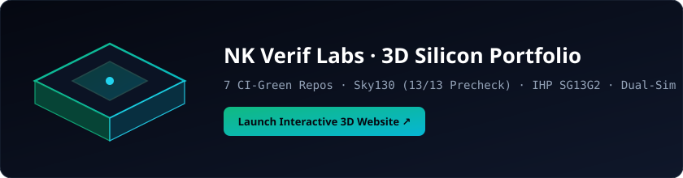

  

# NK Verif Labs

**Independent digital IP verification and RTL-to-GDSII physical design studio.**
We build verification environments that catch bugs early, and push open-source silicon through to sign-off.

[Portfolio](https://niranjankumarkatragadda.github.io) · [Blog](https://niranjankumarkatragadda.github.io/nk-verif-labs-site/) · [nkveriflabs@gmail.com](mailto:nkveriflabs@gmail.com)

---

## What we do

| Service | What you get |
| --- | --- |
| **Cocotb testbenches and protocol VIPs** | Python/cocotb verification environments for your block: AXI4 / AXI-Stream, APB3, PCIe, SerDes, async CDC, NoC. Randomized stimulus, scoreboards, checkers and coverage. |
| **Dual-simulator CI** | GitHub Actions regressions on Verilator and Icarus Verilog, for RTL and post-PnR gate-level, so every commit is checked automatically. |
| **RTL-to-GDSII bring-up** | LibreLane / OpenLane / OpenROAD flows on Sky130 and IHP SG13G2: floorplan, timing closure, STA. |
| **Pre-shuttle sign-off** | DRC/LVS with KLayout, Magic and Netgen, plus `cf-precheck`, so your design is ready to submit. |

**Typical engagements:** a fixed-scope verification sprint, a physical-design bring-up for one block, or CI setup for an existing repo. Get in touch with your block, target PDK and timeline.

---

## Start here: open-source templates

| Template | Use it for |
| --- | --- |
| [`cocotb-dual-sim-template`](https://github.com/nk-verif-labs/cocotb-dual-sim-template) | Cocotb + Verilator + Icarus Verilog dual-simulator CI starter |
| [`librelane-pdk-ci-template`](https://github.com/nk-verif-labs/librelane-pdk-ci-template) | LibreLane RTL-to-GDSII (IHP SG13G2 / Sky130) with dual-sim cocotb CI |
| [`sky130-cf-precheck-template`](https://github.com/nk-verif-labs/sky130-cf-precheck-template) | Sky130 Caravel `io_oeb` wrapper sanity + dual-sim pre-shuttle starter |

Click **Use this template** on either repo to get a working CI setup in minutes.

---

## Selected work

**Physical design**
- [128 Gbps AES-256-GCM Engine (ASAP7 7nm, Dual-Sim Cocotb CI)](https://github.com/nk-verif-labs/asap7-aes256-gcm-100g)
- [6G LDPC Min-Sum Decoder (ASAP7 7nm, 1.203 GHz, 0 DRC, LEC PASS)](https://github.com/nk-verif-labs/asap7-6g-ldpc-decoder)
- [6G Baseband TX (GF180MCU, 6.4 Gbps, 0 DRC, Clean LVS)](https://github.com/nk-verif-labs/gf180-6g-baseband-tx)
- [5-Stage RV32I SoC (Sky130, 13/13 cf-precheck)](https://github.com/NiranjankumarKatragadda/riscv-rv32i-physical-design)
- [4x4 Systolic Array (IHP SG13G2)](https://github.com/NiranjankumarKatragadda/ihp-sg13g2-systolic-array)
- [16-Beat AXI4 DMA (IHP SG13G2)](https://github.com/NiranjankumarKatragadda/ihp-sg13g2-axi4-dma)

**Verification IP**
- [4x4 NoC Mesh VIP](https://github.com/NiranjankumarKatragadda/noc-mesh-4x4-cocotb-vip) ([3D demo](https://niranjankumarkatragadda.github.io/noc-mesh-3d.html))
- [Async CDC FIFO VIP](https://github.com/NiranjankumarKatragadda/async-cdc-fifo-cocotb-vip)
- [AXI4-Stream Arbiter VIP](https://github.com/NiranjankumarKatragadda/axis-skid-arbiter-cocotb-vip)
- [8b/10b SerDes PRBS VIP](https://github.com/NiranjankumarKatragadda/serdes-8b10b-prbs-cocotb-vip)

---

## Toolchain

`Python` · `cocotb` · `cocotbext-axi` · `cocotbext-pcie` · `Verilator` · `Icarus Verilog` · `GitHub Actions` · `LibreLane` · `OpenLane` · `OpenROAD` · `OpenSTA` · `KLayout` · `Magic` · `Netgen` · `Cadence Genus / Innovus / Tempus`

---

## Work with us

Email **nkveriflabs@gmail.com** with your block, target PDK or flow, and timeline. You'll get a scoped proposal back.
